# MotoTrack

**A garage, logbook and glovebox for motorcycle owners in the Philippines.**
Track your bikes and their mileage, log every service, keep your OR/CR, insurance and license on your phone, look up specs and DIY guides, and ask an AI mechanic, with reminders before anything is due.

Built with Expo (React Native) and TypeScript on Firebase, designed to run entirely on Firebase's free Spark plan.

[](https://github.com/ChristianAlicaba2002/mototrack-wiki/actions/workflows/ci.yml)


## Screenshots

| Sign in | Create account | Service log | Update odometer |
| :---: | :---: | :---: | :---: |
| 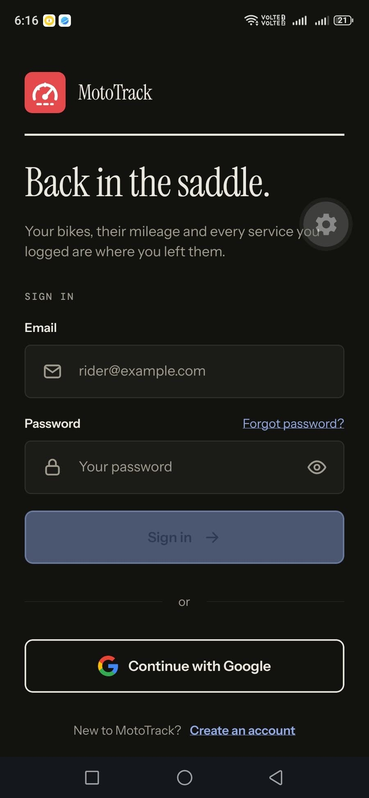 | 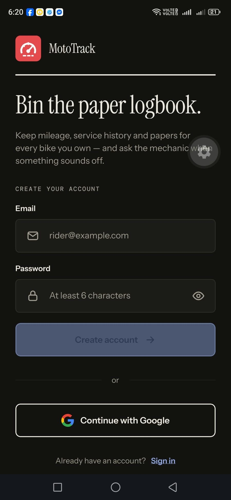 | 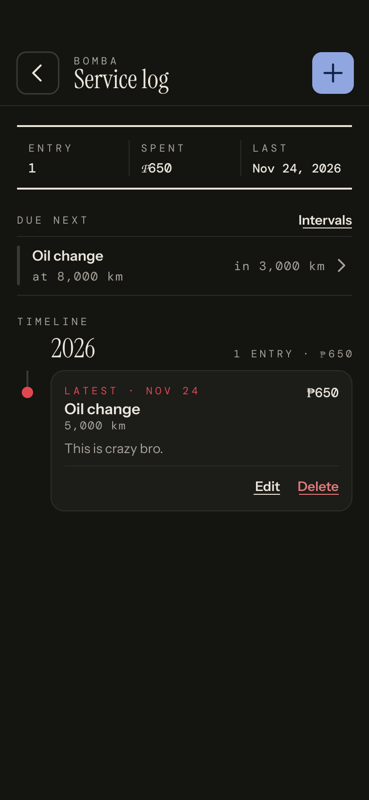 | 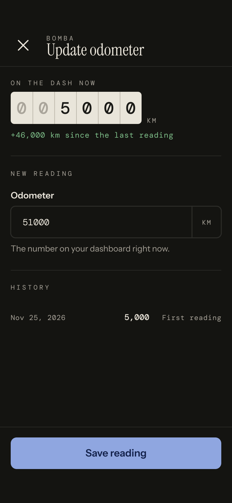 |

| Edit motorcycle | Vault | Add a document | Settings |
| :---: | :---: | :---: | :---: |
| 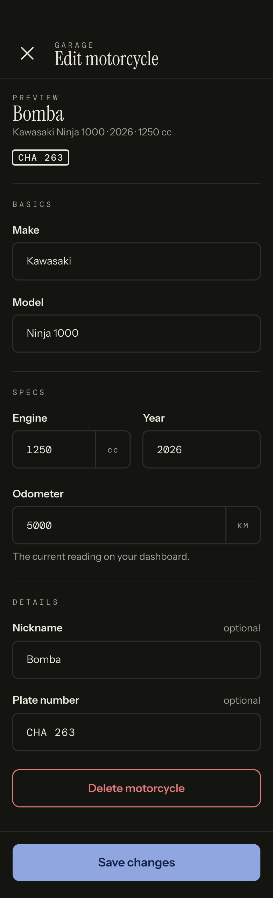 | 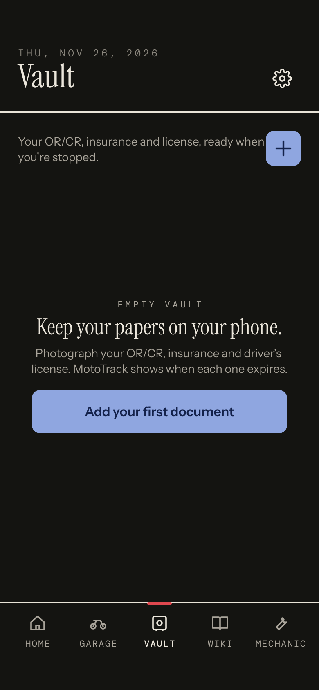 | 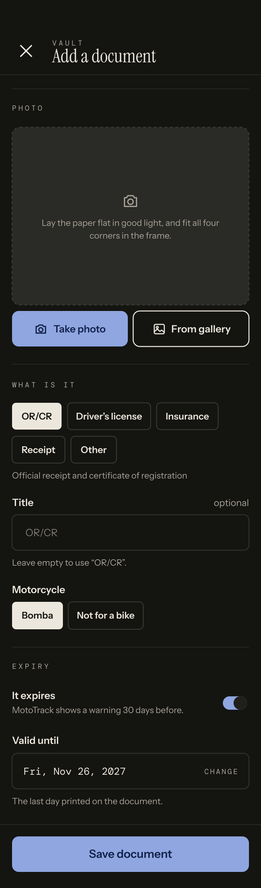 | 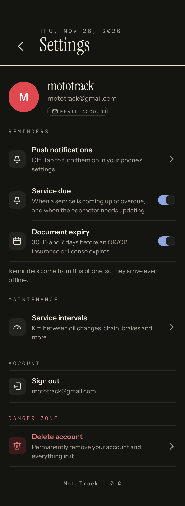 |

| Wiki | Wiki filters | Spec sheet | AI Mechanic |
| :---: | :---: | :---: | :---: |
| 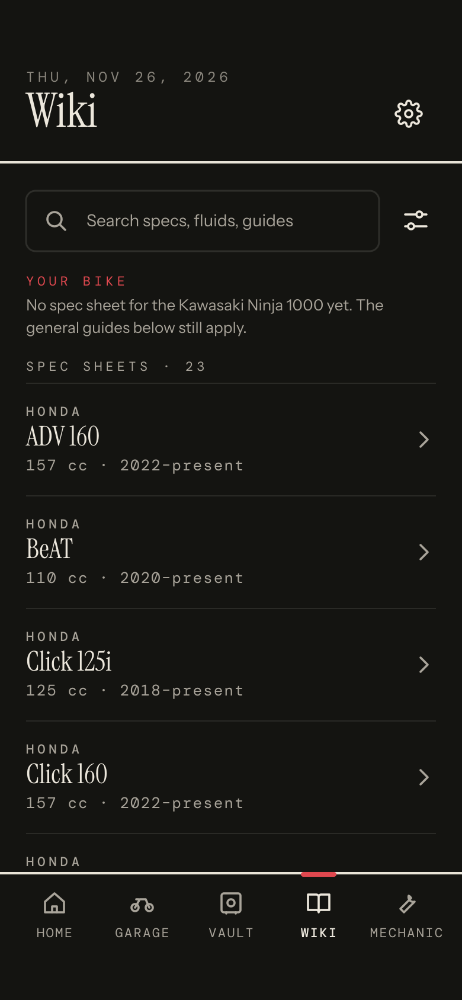 | 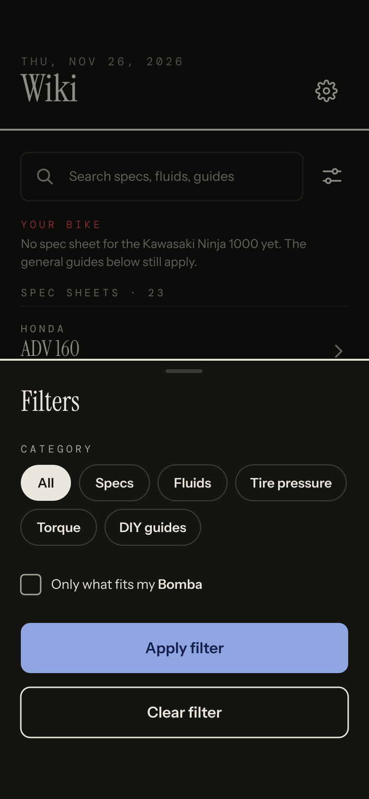 | 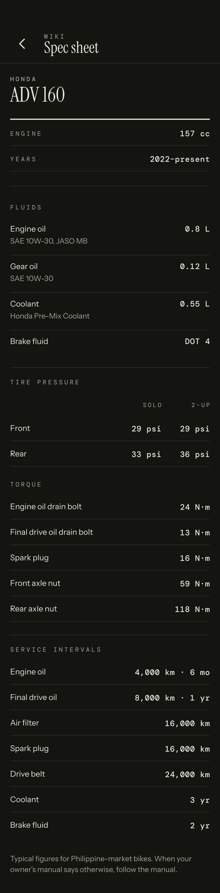 | 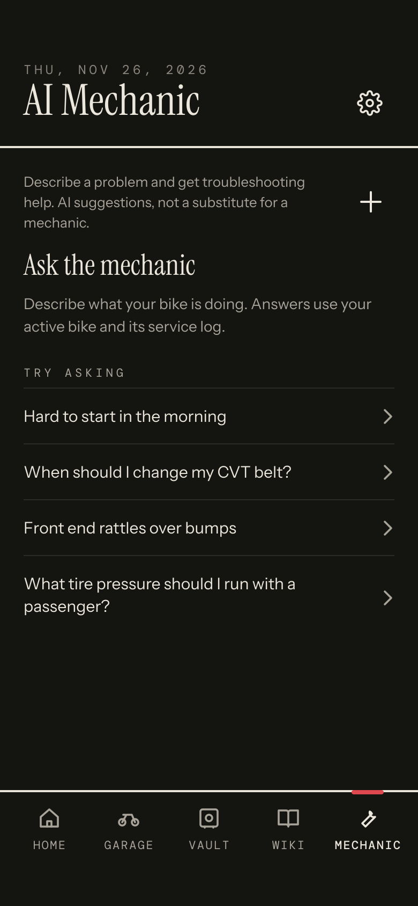 |

| New chat | Chat |
| :---: | :---: |
| 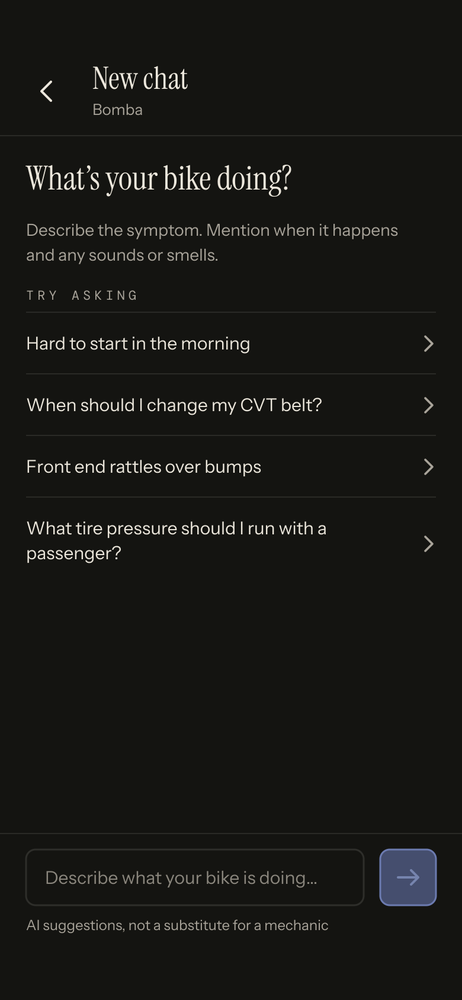 | 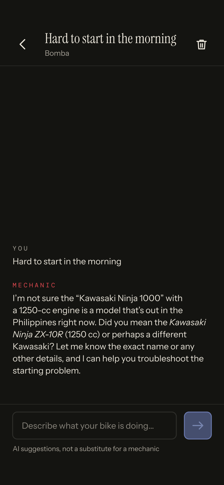 |

## Features

**Garage and mileage**
- Add several motorcycles (make, model, cc, year, plate, nickname) and pick the active one.
- Log odometer readings; the history is kept per bike, and readings can't go backwards.

**Maintenance**
- Log services (oil change, chain, brakes, tires and more) with date, mileage, cost and notes.
- A per-bike timeline, and a **Due next** list worked out from the mileage and the rider's own service intervals.
- Expense summary: spending by month, by service type and by bike.

**Document vault**
- Photograph your OR/CR, driver's license, insurance and receipts. The list shows each one as **Valid**, **Expiring soon** or **Expired**, with filters.
- Full-screen viewer with pinch-to-zoom, double-tap and swipe-to-close.
- An AI check (vision model) rejects a photo that isn't the chosen document, e.g. a random picture saved as a license.
- Replace or delete a document; replacing never loses the old photo if the upload fails.

**Reminders** (all scheduled on the phone, so they work offline and need no server)
- When a service is due soon or overdue.
- When the odometer hasn't been updated for 14 days.
- 30, 15 and 7 days before a document expires.

**Wiki**
- 23 spec sheets for popular Philippine models and 20 DIY guides, with search and category filters.

**AI Mechanic**
- Troubleshooting chat that knows the rider's bike, its recent services and its spec sheet. It checks that the bike is a real model before giving advice, and formats answers with Markdown.

**Account**
- Email/password or Google sign-in, light and dark mode, push notification setup (FCM), and full account deletion that removes every piece of the rider's data.

## Tech stack

| Area | Choice |
| --- | --- |
| App | Expo SDK 58, React Native 0.88, React 19.3 with React Compiler |
| Language | TypeScript 6 (strict) |
| Navigation | Expo Router (file-based, typed routes) |
| Backend | Firebase Authentication, Cloud Firestore |
| Notifications | `expo-notifications` (local reminders + FCM device tokens) |
| AI | Groq API: `openai/gpt-oss-20b` for chat, a vision model for document checks |
| Animation / gestures | Reanimated 4, Gesture Handler 3 |
| Media | `expo-image`, `expo-image-picker` |
| Quality | ESLint, `tsc`, Expo Doctor, Firestore rules tests on the emulator, GitHub Actions CI |

## How it's built

- **Feature folders with view models.** Each feature in `src/features/<feature>/` has a `model/` (hooks, view models and pure logic) and a `ui/` (presentational components that only render what the view model gives them). Route files in `src/app/` are one line that renders a feature screen.
- **Pure logic, kept separate.** Things like "what's due next", expiry status and reminder dates are plain functions with no React or Firebase, so they're easy to read and test.
- **Free-tier by design.** Cloud Storage and Cloud Functions need the paid Blaze plan, so:
  - Vault photos are stored in Firestore as base64 chunks under the document (up to about 5 MB).
  - Reminders are local notifications the phone schedules for itself.
- **Security rules as the backend.** Every user's data lives under `users/{uid}`. The rules check the owner, exact field sets, types, limits and server timestamps, and are tested against the Firestore emulator in CI.
- **Plain-language errors.** Firebase error codes are turned into sentences that say what didn't happen and what to do.

## Getting started

### Prerequisites
- Node.js 22 and pnpm
- An Android device or emulator
- A **development build**: Google sign-in and push notifications don't work in Expo Go
- Java 21+ only if you want to run the security rules tests

### 1. Install
```bash
pnpm install
```
To add a package, use `npx expo install <package>` so the version matches SDK 58.

### 2. Configure Firebase (free Spark plan)
1. Create a Firebase project and register a **Web app** and an **Android app** (package `com.mototrack.wiki`).
2. Copy `.env.example` to `.env` and fill in the Web app config values.
3. Download the Android app's `google-services.json` to `src/google-services.json`.
4. In the console, enable **Authentication → Email/Password and Google**, and create a **Firestore** database.
5. Deploy the security rules and indexes:
   ```bash
   pnpm dlx firebase-tools@15.36.0 login
   pnpm dlx firebase-tools@15.36.0 deploy --only firestore:rules,firestore:indexes
   ```
6. Optional: set `EXPO_PUBLIC_GROQ_API_KEY` (free key from [console.groq.com](https://console.groq.com)) to enable the AI Mechanic and the document photo check.

`EXPO_PUBLIC_*` values are bundled into the app, so use a free-tier Groq key. For EAS builds, set the same values as EAS environment variables; `.env` is not uploaded.

### 3. Build and run
```bash
# Development build on a connected device or emulator
pnpm exec expo run:android
# or in the cloud
bunx eas-cli build --profile development --platform android

# Then start the dev server
pnpm start
```

### 4. Seed the wiki (optional)
Spec sheets and guides live as JSON in [`wiki/specs/`](wiki/specs/) and [`wiki/guides/`](wiki/guides/).
```bash
pnpm seed:wiki --dry-run                                # validate the files
FIRESTORE_EMULATOR_HOST=127.0.0.1:8080 pnpm seed:wiki   # seed the emulator
pnpm seed:wiki                                          # seed the real project
```
Seeding the real project needs a service account key (Project settings → Service accounts). Keep it out of the repo and set `FIREBASE_SERVICE_ACCOUNT_PATH` in `.env`.

## Scripts

| Script | What it does |
| --- | --- |
| `pnpm start` | Start the Expo dev server |
| `pnpm android` | Start and open on Android |
| `pnpm lint` | ESLint through Expo |
| `pnpm typecheck` | `tsc --noEmit` |
| `pnpm doctor` | Expo Doctor: dependency and config checks |
| `pnpm test:rules` | Firestore and Storage security rules tests on the emulators |
| `pnpm seed:wiki` | Upsert the wiki seed files into Firestore |

CI runs lint, typecheck, Expo Doctor, an Android JS bundle and the rules tests on every pull request to `develop` and `main`.

## Data model

All data lives under the signed-in user's own document, and only the owner can read or write it.

| Path | Contents |
| --- | --- |
| `users/{uid}` | Profile, active bike, service intervals, reminder settings |
| `users/{uid}/bikes/{bikeId}` | A motorcycle and its current odometer |
| `users/{uid}/bikes/{bikeId}/odometerReadings/{id}` | Odometer history (append-only) |
| `users/{uid}/services/{serviceId}` | A maintenance log entry |
| `users/{uid}/documents/{documentId}` | A vault document: type, title, expiry, photo info |
| `users/{uid}/documents/{documentId}/photoChunks/{photoId}_{n}` | The document's photo as base64, up to 8 × 900 KB |
| `users/{uid}/devices/{deviceId}` | This phone's FCM token, removed on sign-out |
| `users/{uid}/chats/{chatId}` and `/messages/{id}` | AI Mechanic conversations (messages are append-only) |
| `wiki/{docId}` | Spec sheets and guides, read-only for signed-in users |

Rules: [`firestore.rules`](firestore.rules) · tests: [`tests/rules/`](tests/rules/) · types: [`src/lib/firestore/`](src/lib/firestore/)

## Project structure

```text
src/
├── app/                 # Routes (Expo Router); each file renders a feature screen
│   ├── _layout.tsx      # Root stack: auth guard, theme, reminders, notification taps
│   └── (tabs)/          # Home, Garage, Vault, Wiki, AI Mechanic
├── features/            # One folder per feature, each with model/ and ui/
│   ├── home/  garage/  services/  expenses/  vault/
│   ├── wiki/  ai-mechanic/  reminders/  notifications/
│   └── settings/  login/
├── components/          # Shared UI: tabs, drawers, icons, themed text
├── lib/
│   ├── firebase/        # Firebase setup, Google sign-in
│   ├── firestore/       # Types, typed collections, data access
│   ├── notifications/   # Permission, FCM token, local notifications
│   └── ai/              # Groq client
├── hooks/               # useAuth, useTheme, …
└── constants/           # Theme tokens, tab list
wiki/                    # Seed data for the in-app wiki
tests/rules/             # Security rules tests
scripts/                 # Wiki seeding
```

## Docker sandbox

Run the dev server and checks in a container (Node 22 and pinned pnpm, same as CI) without installing Node locally. It doesn't build the native app; install a development build on your phone and it connects to Metro in the container.

```bash
cp .env.example .env
REACT_NATIVE_PACKAGER_HOSTNAME=<your LAN IP> docker compose up --build   # Metro on port 8081
docker compose run --rm app pnpm lint
docker compose run --rm app pnpm typecheck
```

After changing `package.json`, run `docker compose run --rm app pnpm install`. To reset, `docker compose down -v`.

## Roadmap

- [x] Sign-in (email/password and Google)
- [x] Garage, odometer history and active bike
- [x] Service log, timeline, intervals and expense summary
- [x] Document vault with expiry status, viewer and AI photo check
- [x] Wiki: spec sheets, DIY guides, search
- [x] AI Mechanic chat
- [x] Service, odometer and document expiry reminders
- [ ] iOS release (local reminders already work; push needs APNs)
- [ ] Server-sent reminders once the project moves to the Blaze plan

## License

MIT. See [LICENSE](LICENSE).
